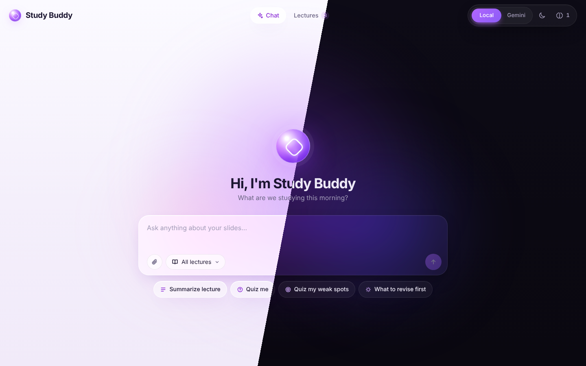
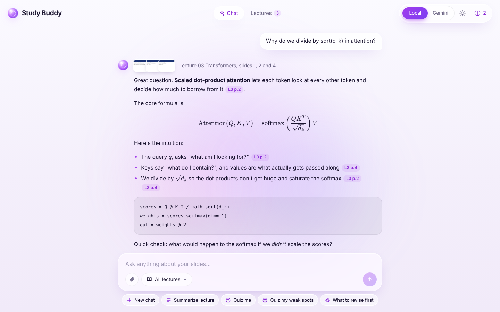
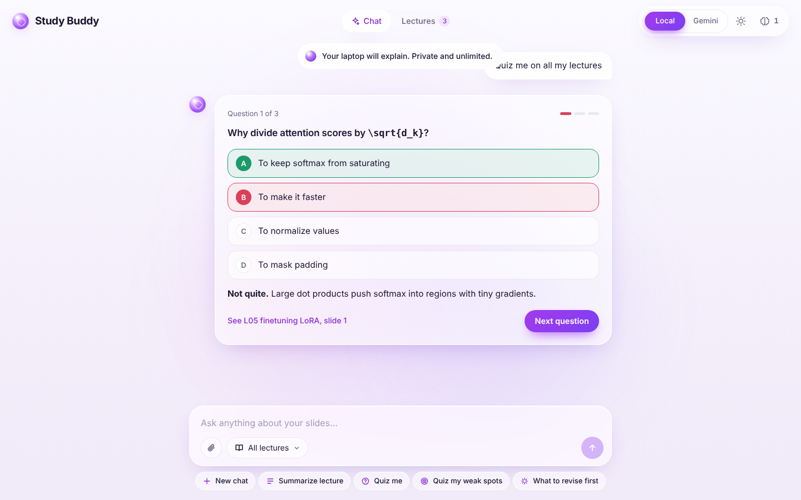
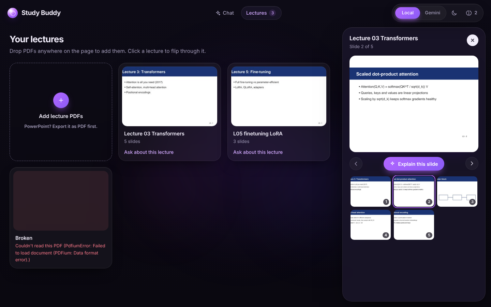
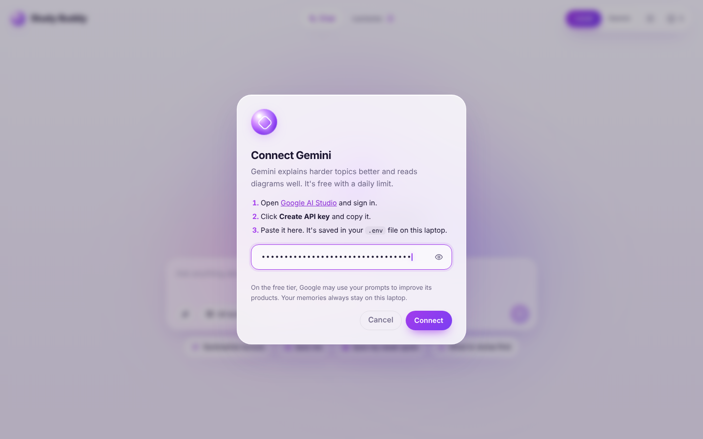

<div align="center">

# Study Buddy

**A self-learning AI tutor for your own lecture slides.**<br>
It explains your course material, cites the exact slide, quizzes you, and remembers what you find hard. It runs free on your laptop.



</div>

## Why I built this

Lecture slides are dense, and general chatbots don't know what *my* professor actually taught. I wanted a tutor that answers from my own slides, points me to the right one, and gets better at teaching me over time: skipping what I already understand and coming back to what I keep getting wrong.

## Features

- **Answers grounded in your slides.** Ask anything; it finds the relevant slides (RAG), explains them, and cites them inline as `L3 p.2`. Click a citation to open that slide.
- **Explain this slide.** Flip through any lecture and ask for a walkthrough. Vision-capable models look at the slide image too, so diagrams and plots count.
- **Self-learning memory.** After every chat and quiz, it extracts facts about you as a learner ("confused about why attention scales by √d_k", "learns well from code examples") and adds, updates or deletes memories with [Mem0](https://github.com/mem0ai/mem0). Every answer is adapted using them, and you can see or delete everything it knows about you.
- **Quizzes that target your weak spots.** Multiple-choice quizzes from your slides; wrong answers become memories, and "Quiz my weak spots" builds questions from them.
- **Lecture summaries** for quick revision.
- **Free, local and private.** Runs on Ollama with Gemma on your own machine. Optionally switch to Google's free Gemini API for harder topics.
- **Light and dark mode**, a glass UI with a gliding spring-animated caret, and a layout that works on mobile.

| Chat with citations | Quiz with feedback |
|---|---|
|  |  |

| Lectures and slide viewer | Connect Gemini |
|---|---|
|  |  |

## How it works

```
 lecture PDF ──► pypdfium2 ──► slide text + slide images
                                     │
                                     ▼
                       nomic-embed-text ──► one vector per slide

 question ──► hybrid slide search (embeddings + exact keywords) ──┐
         └──► relevant memories about the student (Mem0) ─────────┤
                                                                  ▼
                prompt = tutor rules + memories + top slides (+ slide images)
                                                                  │
                                                                  ▼
                       Gemma (Ollama)  or  Gemini  ──► streamed answer with [S1] citations
                                                                  │
                                                                  ▼
           background: extract facts about the student ──► ADD / UPDATE / DELETE memories
```

A few design decisions:

- **One chunk per slide.** Slides are already self-contained ideas, so each slide is one retrieval unit, which also makes citations exact.
- **No vector database for slides.** A course is a few thousand slides at most, so a NumPy matrix search is instant. Embeddings miss acronyms like "LoRA" or "KV cache", so results get a small boost for exact keyword matches.
- **Memory is about the student, not the subject.** A custom fact-extraction prompt tells Mem0 to store understanding, confusions, preferences and deadlines, never course facts (those already live in the slides).
- **Memory runs after the answer streams,** on a background worker, so learning never slows down a reply.
- **Graceful fallback.** If Mem0 can't start, a ~100-line built-in version of the same two-phase idea (extract facts, then reconcile) takes over.

## Tech stack

| Part | Tools |
|---|---|
| Backend | Python, Starlette, Uvicorn |
| Models | Ollama (Gemma 4 for chat and memory, `nomic-embed-text` for embeddings), optional Gemini API |
| Memory | Mem0 with a local Qdrant store |
| PDFs | pypdfium2, Pillow |
| Frontend | Vanilla HTML/CSS/JS with no build step, KaTeX for maths, View Transitions API for the theme switch |

## Getting started (Windows)

1. Install [Python 3.12](https://www.python.org/downloads/) (tick **Add python.exe to PATH**) and [Ollama](https://ollama.com/download).
2. Clone this repo, then double-click **`setup.bat`**. It installs the packages and downloads the local models.
3. Double-click **`start.bat`**. Study Buddy opens at http://127.0.0.1:8000.
4. Drop your lecture PDFs onto the page. For PowerPoints, export to PDF first.

On macOS or Linux:

```bash
python -m venv .venv && source .venv/bin/activate
pip install -r requirements.txt
cp .env.example .env
python pull_models.py
python run.py
```

### Using Gemini (optional)

Click **Gemini** in the top-right switch and paste a free key from [Google AI Studio](https://aistudio.google.com/apikey). The app checks it and saves it to `.env`. The free tier has a daily limit, and Google may use free-tier prompts to improve its products; memories always stay local.

### Configuration

Everything lives in `.env`:

| Setting | Default | What it does |
|---|---|---|
| `CHAT_MODEL` | `gemma4:e4b` | Explains things; can read slide images. Try `gemma4:26b` for better answers if you have the RAM. |
| `MEMORY_MODEL` | same as chat | Decides what to remember about you. |
| `EMBED_MODEL` | `nomic-embed-text` | Finds relevant slides. Changing it re-indexes automatically. |
| `GEMINI_MODEL` | `gemini-flash-latest` | Always points at Google's newest Flash model. |
| `MEMORY_BACKEND` | `mem0` | `mem0` or `builtin`. |

After changing a local model, run `python pull_models.py` to download it.

## Project structure

```
app/
  main.py      web server and API routes
  slides.py    PDF reading, slide images, hybrid slide search
  memory.py    self-learning memory: Mem0 + built-in fallback
  llm.py       Ollama and Gemini clients, streaming, embeddings
  prompts.py   every prompt in one place
  config.py    settings from .env
static/        the web app (index.html, style.css, app.js)
docs/          screenshots for this README
```

Your slides, memories and API key stay out of git (`data/` and `.env` are in `.gitignore`).

## Troubleshooting

- **"Ollama isn't running"**: open the Ollama app, then refresh the page.
- **"The model … isn't downloaded"**: run `ollama pull <model>` or `python pull_models.py`.
- **A lecture shows an error**: hover it and click retry. Scanned PDFs have no text layer, so search can't find them, but "Explain this slide" still works with a vision model.
- **Slow answers**: Ollama can use Intel Arc / AMD GPUs through Vulkan in recent versions; check Ollama's docs. Smaller models are faster too.
- **Maths shows as raw LaTeX**: KaTeX loads from a CDN, so it needs an internet connection.

## Ideas for later

- Support PowerPoint files directly
- Spaced-repetition flashcards generated from weak spots
- Answer from handwritten notes and past papers too

## Credits

- The memory loop is inspired by Dave Ebbelaar's [Mem0 tutorial](https://github.com/daveebbelaar/ai-cookbook/tree/main/knowledge/mem0).
- Built on [Mem0](https://github.com/mem0ai/mem0), [Ollama](https://ollama.com), [Gemma](https://ai.google.dev/gemma), [pypdfium2](https://github.com/pypdfium2-team/pypdfium2) and [KaTeX](https://katex.org).
- The gliding caret is adapted from a SmoothInput React component to vanilla JS with multi-line support.

## License

[MIT](LICENSE).

<div align="center">
Made with ❤️ by Prashant Jangir
</div>
